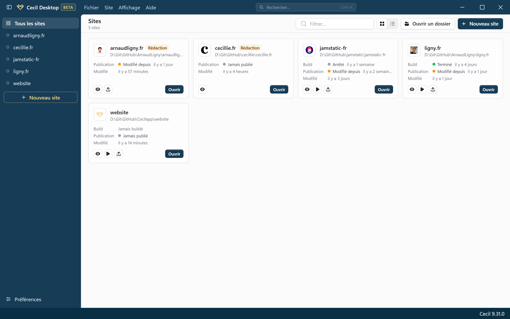

Cecil est un outil en ligne de commande, et il le restera. Mais tout le monde n’a pas envie d’ouvrir un terminal pour écrire une page, vérifier un build ou publier un site. Nous sommes donc heureux d’annoncer que **[Cecil Desktop](https://desktop.cecil.app/fr/) est disponible en bêta**, pour Windows et macOS.

### Du Markdown au site en ligne, en un clic

Cecil Desktop est une application desktop native pour gérer, générer, prévisualiser et publier vos sites Cecil. **Cecil est embarqué**, ainsi que PHP : il n’y a rien d’autre à installer sur votre machine.

- **Sites** : ouvrez un projet existant (ou déposez son dossier sur la fenêtre), ou créez-en un nouveau avec un assistant.
- **Contenu** : parcourez l’arborescence des pages, éditez le Markdown avec une barre d’outils, des raccourcis et un aperçu du rendu, remplissez le front matter via un formulaire, et déposez, collez ou choisissez des images.
- **Build** : générez le site avec des options (brouillons, URL de base, optimisation…), suivez les logs en direct, avec les problèmes regroupés par message, et conservez l’historique de vos builds.
- **Aperçu** : le serveur local de Cecil, avec rechargement automatique, ouvert dans votre navigateur.
- **Diagnostics** : vérifications du projet, du front matter, du SEO, des liens et du cache, avec des résultats lisibles.
- **Configuration** : un formulaire pour chaque option, ou le YAML brut, vérifié comme Cecil le charge.
- **Thèmes** : parcourez, installez et mettez à jour les thèmes Cecil publiés sur Packagist, sans Composer.
- **Publication** : déployez sur GitHub Pages, Netlify, Vercel ou AWS S3 directement via leurs API, sans aucune CLI. Seuls les fichiers modifiés sont envoyés, et les jetons sont chiffrés avec le trousseau du système.
- **Mode Rédaction** : confiez un site à un client, un rédacteur ou une équipe : ils retrouvent leurs pages, les médias, l’aperçu et la publication, et rien d’autre.

Palette de commandes, menus et notifications natifs, thèmes clair et sombre, interface en français et en anglais : c’est une vraie application desktop.

### Vos sites restent des sites Cecil

Cecil Desktop ne déplace et ne convertit rien : vos sites restent des projets Cecil standards, sur votre disque, que vous pouvez toujours générer en [ligne de commande](/fr/documentation/) ou dans votre CI. L’application est pensée pour le contenu, une page s’ouvre dans votre éditeur favori en un clic, et les templates restent dans votre éditeur de code.

### Tarifs

Pendant la bêta, **tout est inclus, gratuitement**. Ensuite, Cecil Desktop restera gratuit pour 1 site, et une licence Pro, payée une seule fois sans abonnement, débloquera les sites illimités et les fonctionnalités avancées. Acheter une licence, c’est aussi soutenir le développement de Cecil.

### Essayez-le et donnez votre avis

[Téléchargez Cecil Desktop](https://desktop.cecil.app/fr/#download) pour Windows 10+ ou macOS 12+ (Intel et Apple Silicon). Linux est prévu. Les applications installées téléchargent elles-mêmes leurs mises à jour (Windows pour l’instant, macOS bientôt), chacune avec la dernière version de Cecil.

Les installeurs ne sont pas encore signés, votre système signale donc un éditeur inconnu : sous Windows, cliquez sur *Informations complémentaires* puis *Exécuter quand même* ; sous macOS, ouvrez *Réglages Système › Confidentialité et sécurité* et cliquez sur *Ouvrir quand même*.

C’est une bêta : vos retours comptent ! Utilisez *Aide › Envoyer un retour* dans l’application pour signaler un bug ou suggérer une amélioration. Consultez la [documentation de Cecil Desktop](https://desktop.cecil.app/fr/docs/getting-started/) pour bien démarrer.
