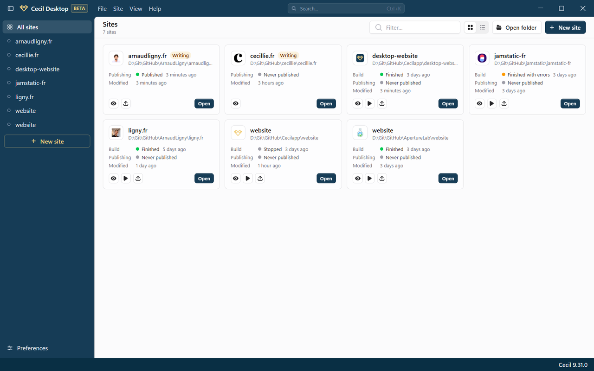

Cecil is a command line tool, and it will stay one. But not everyone wants to open a terminal to write a page, check a build or publish a website. Today, we're happy to announce that **[Cecil Desktop](https://desktop.cecil.app) is available in beta**, for Windows and macOS.

### From Markdown to live site, in one click

Cecil Desktop is a native desktop app to manage, build, preview and publish your Cecil sites. **Cecil is embedded**, as well as PHP: there is nothing else to install on your machine.

- **Sites**: open an existing project (or drop its folder on the window), or create a new one with a wizard.
- **Content**: browse the pages tree, edit Markdown with a toolbar, shortcuts and a rendered preview, fill the front matter through a form, and drop, paste or pick images.
- **Build**: build with options (drafts, base URL, optimization…), follow the logs live, with problems grouped by message, and keep the history of your builds.
- **Preview**: Cecil's local server, with live reload, opened in your browser.
- **Diagnostics**: checks of the project, front matter, SEO, links and cache, with readable results.
- **Configuration**: a form for every option, or the raw YAML, checked like Cecil loads it.
- **Themes**: browse, install and update the Cecil themes published on Packagist, without Composer.
- **Publishing**: deploy to GitHub Pages, Netlify, Vercel or AWS S3 directly through their APIs, without any CLI. Only the changed files are sent, and tokens are encrypted with the system keychain.
- **Writing mode**: hand a site to a client, a writer or a team: they get their pages, the media, the preview and publishing, and nothing else.

Command palette, native menus and notifications, light and dark themes, English and French interface: it's a real desktop app.

### Your sites stay Cecil sites

Cecil Desktop doesn't move or convert anything: your sites stay standard Cecil projects, on your disk, that you can still build with the [command line](/documentation/) or in your CI. The app is made for content, a page opens in your favorite editor in one click, and templates stay in your code editor.

### Pricing

During the beta, **everything is included, for free**. Then, Cecil Desktop will remain free for 1 site, and a Pro license, paid once without subscription, will unlock unlimited sites and advanced features. Buying a license also supports the development of Cecil.

### Try it and share your feedback

[Download Cecil Desktop](https://desktop.cecil.app/#download) for Windows 10+ or macOS 12+ (Intel and Apple Silicon). Linux is planned. Installed apps download their updates on their own (Windows for now, macOS soon), each one with the latest Cecil inside.

The installers are not signed yet, so your system warns about an unknown publisher: on Windows, click *More info* then *Run anyway*; on macOS, open *System Settings › Privacy & Security* and click *Open Anyway*.

It's a beta: your feedback matters! Use *Help › Send feedback* in the app to report a bug or suggest an improvement. See the [Cecil Desktop documentation](https://desktop.cecil.app/docs/getting-started/) to get started.
